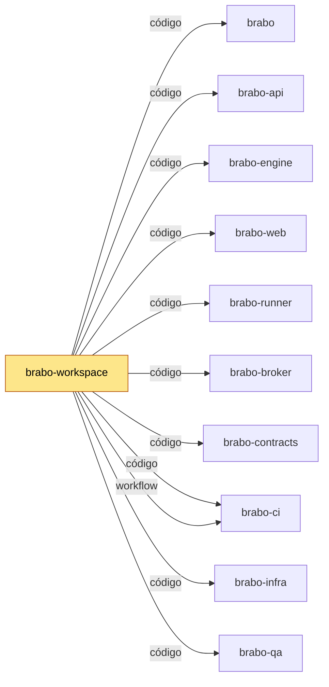

# brabo-workspace

Pasta-mãe que reúne os repositórios `brabo-*` lado a lado, num lugar só, sem código de produto.

## Para que existe

Os repositórios do Brabo são separados por camada, e vários dependem uns dos outros pelo caminho da pasta: o `brabo-infra` sobe o ambiente de dev construindo cada serviço a partir dos clones irmãos. Este repositório junta esses clones numa pasta (`~/dev/brabo/`) com um script. Depois de ler, você diz em uma linha: ele existe separado porque é só o endereço onde os irmãos moram.

## Onde se encaixa

<!-- mapa:inicio -->
<!-- Gerado do repos.yml do brabo por brabo-ci:scripts/ci/mapa-dos-repos.ts. Não edite à mão. -->

**brabo-workspace** — Pasta-mãe `~/dev/brabo/` com os clones lado a lado e o `clonar-tudo.sh`. Quem desenvolve roda `clonar-tudo.sh` uma vez; as sessões do Claude abrem nela.

| repo | propósito | como é usado | depende de | é usado por |
|---|---|---|---|---|
| brabo | Porta de entrada do produto — documentação agregada, site, instalador e release. | Quem instala usa o `install.sh` e as imagens e o binário das tags de `componentes.json`; o brabo-infra o clona nas aferições cruzadas. | brabo-api (imagem, doc), brabo-engine (imagem, doc), brabo-web (imagem, doc), brabo-broker (imagem, doc), brabo-runner (imagem, doc), brabo-infra (imagem, código, doc), brabo-contracts (contrato, doc), brabo-ci (doc, workflow), brabo-qa (doc) | brabo-ci (contrato), brabo-infra (código), brabo-workspace (código) |
| brabo-api | API do produto (NestJS, Drizzle, PostgreSQL/pgvector) — schema, RBAC, LLM, metering e gates. | Imagem publicada por tag e consumida pelo brabo e pelo brabo-infra; o brabo-web, o brabo-engine e o brabo-qa leem o código ou o `openapi.json` dele. | brabo-contracts (contrato), brabo-infra (código), brabo-qa (workflow), brabo-ci (workflow) | brabo (imagem, doc), brabo-engine (código), brabo-web (contrato), brabo-contracts (contrato), brabo-infra (código), brabo-qa (código), brabo-workspace (código) |
| brabo-engine | Engine (Elixir/OTP, Phoenix, Oban) — agentes, sessões, gates e roteamento de runners. | Imagem publicada por tag, usada pelo brabo e pelo brabo-infra. | brabo-contracts (contrato), brabo-api (código), brabo-runner (código), brabo-qa (workflow), brabo-ci (workflow) | brabo (imagem, doc), brabo-infra (código), brabo-qa (código), brabo-workspace (código) |
| brabo-web | Interface web (React 19, Vite) — telas, i18n e design system. | Imagem publicada por tag, usada pelo brabo e pelo brabo-infra. | brabo-contracts (contrato), brabo-api (contrato), brabo-qa (workflow), brabo-ci (workflow) | brabo (imagem, doc), brabo-infra (código), brabo-qa (código), brabo-workspace (código) |
| brabo-runner | CLI `brabo-runner` na máquina do usuário — PTY, container local e espelho. | Binário publicado por tag, instalado pelo brabo; o brabo-engine e o brabo-qa leem o código dele nos testes. | brabo-contracts (contrato), brabo-ci (workflow) | brabo (imagem, doc), brabo-engine (código), brabo-infra (código), brabo-qa (código), brabo-workspace (código) |
| brabo-broker | Único processo com o socket do Docker do servidor. | Imagem publicada por tag, usada pelo brabo e pelo brabo-infra. | brabo-contracts (contrato), brabo-qa (workflow), brabo-ci (workflow) | brabo (imagem, doc), brabo-infra (código), brabo-qa (código), brabo-workspace (código) |
| brabo-contracts | Contratos compartilhados — os pacotes `shared` e `docker-port`, `areas.json` e `fluxo.yml`. | Consumido por TAG (pacote no GitHub Packages ou arquivo baixado por raw na mesma tag); uma tag nova pede bump em api, web, runner, broker, engine, qa e infra. | brabo-api (contrato), brabo-ci (workflow) | brabo (contrato, doc), brabo-api (contrato), brabo-engine (contrato), brabo-web (contrato), brabo-runner (contrato), brabo-broker (contrato), brabo-infra (código), brabo-qa (contrato), brabo-workspace (código) |
| brabo-ci | Workflows reutilizáveis e a política de PR, escada de aprovação, promoção, tag e Dependabot. | Cada repo chama `uses: viralabs-dev/brabo-ci/...@<sha>`, fixado por SHA. | brabo-qa (contrato, workflow), brabo (contrato) | brabo (doc, workflow), brabo-api (workflow), brabo-engine (workflow), brabo-web (workflow), brabo-runner (workflow), brabo-broker (workflow), brabo-contracts (workflow), brabo-infra (workflow), brabo-qa (workflow), brabo-workspace (código, workflow) |
| brabo-infra | Composes, Dockerfiles de integração, `deploy/k8s`, scripts de dev, release e cadeia de suprimentos. | O brabo clona o brabo-infra no ref de `componentes.json` para subir a instalação; o brabo-api e o brabo-qa o clonam no CI. | brabo-api (código), brabo-engine (código), brabo-web (código), brabo-broker (código), brabo-runner (código), brabo-contracts (código), brabo (código), brabo-qa (workflow), brabo-ci (workflow) | brabo (imagem, código, doc), brabo-api (código), brabo-qa (código), brabo-workspace (código) |
| brabo-qa | E2E de navegador (Playwright), golden-sets e catálogo de funcionalidades — o portão da `main`. | O brabo-ci dispara o `e2e-pr` dele e lê o `funcionalidades.yml`; api, engine, web, broker e infra o chamam como portão. | brabo-api (código), brabo-engine (código), brabo-web (código), brabo-runner (código), brabo-broker (código), brabo-infra (código), brabo-contracts (contrato), brabo-ci (workflow) | brabo (doc), brabo-api (workflow), brabo-engine (workflow), brabo-web (workflow), brabo-broker (workflow), brabo-ci (contrato, workflow), brabo-infra (workflow), brabo-workspace (código) |
| **brabo-workspace** | Pasta-mãe `~/dev/brabo/` com os clones lado a lado e o `clonar-tudo.sh`. | Quem desenvolve roda `clonar-tudo.sh` uma vez; as sessões do Claude abrem nela. | brabo (código), brabo-api (código), brabo-engine (código), brabo-web (código), brabo-runner (código), brabo-broker (código), brabo-contracts (código), brabo-ci (código, workflow), brabo-infra (código), brabo-qa (código) | — |


<!-- mapa:fim -->

## Como é usado

Quem desenvolve clona esta pasta uma vez e roda o script, que clona por HTTPS cada `brabo-*` que ainda não existe ao lado dele:

```bash
git clone https://github.com/viralabs-dev/brabo-workspace.git ~/dev/brabo
cd ~/dev/brabo
./clonar-tudo.sh
```

Nas próximas vezes, o mesmo `./clonar-tudo.sh` faz `git fetch` nos que já existem. Ele nunca apaga nada, e se um clone falhar ele para e diz o nome do repositório.

## Como desenvolver

Pré-requisitos: `git`, `bash` (o script é compatível com bash 3.2, do macOS) e `shellcheck` para o lint.

```bash
bash test/clonar-tudo.test.sh
shellcheck --shell=bash clonar-tudo.sh test/clonar-tudo.test.sh
```

O teste roda o script contra repositórios `file://` falsos numa pasta temporária, então não precisa de rede nem de acesso à organização.

## O que o CI garante

| check | arquivo | o que prova | obrigatório |
|---|---|---|---|
| `script` | `ci.yml` | o shellcheck passa e o teste do `clonar-tudo.sh` fica verde | não |
| `cadeia` (actionlint e pins) | `ci.yml` | os workflows são válidos e todo `uses:` do brabo-ci está preso a um SHA com a versão em comentário | não |
| `pr-police` e `escada` | `politica.yml` | o título e a descrição da PR seguem a política e a aprovação segue a escada | sim |
| `Dependências de merge` | `dependencias.yml` | as PRs citadas em `Depende-de:` já foram mescladas | não |
| `readme-esqueleto` e `mapa-alinhado` | `readme.yml` | o README segue as 8 seções do modelo e o bloco do mapa está em dia com o `repos.yml` do brabo | não |

Os dois primeiros rodam em PR e em push para `dev` e `main`. Os checks opcionais avisam, mas não bloqueiam a PR.

## Documentação

- [`CLAUDE.md`](CLAUDE.md): as regras da pasta-mãe (gitflow, commits, merge na `main` é do dono).
- [`docs/pasta-mae.md`](docs/pasta-mae.md): o histórico do monorepo antigo, como subir o dev com o `brabo-infra` e a variável `BRABO_IRMAOS`.
- [`CHANGELOG.md`](CHANGELOG.md): o que mudou em cada versão.
- Site do produto: <https://viralabs-dev.github.io/brabo/prd/>.

## Como replicar no seu projeto

Copie o padrão, não o conteúdo. Para um produto com vários repositórios, leve estes três arquivos:

- `clonar-tudo.sh`, com a lista de repos numa única variável (`REPOS`);
- `test/clonar-tudo.test.sh`, que testa o script contra repos `file://` locais;
- `.gitignore` com `/brabo*/`, para os clones irmãos não entrarem no repositório da pasta-mãe.

O passo a passo está no guia de adoção do brabo-ci: `scripts/ci/docs/tutorials/adotar.md` (no repositório [brabo-ci](https://github.com/viralabs-dev/brabo-ci)).

## Apoie

Se o projeto te ajuda, você pode [pagar um café no Ko-fi](https://ko-fi.com/daneiel).

## Licença

MIT, ver [LICENSE](LICENSE).
